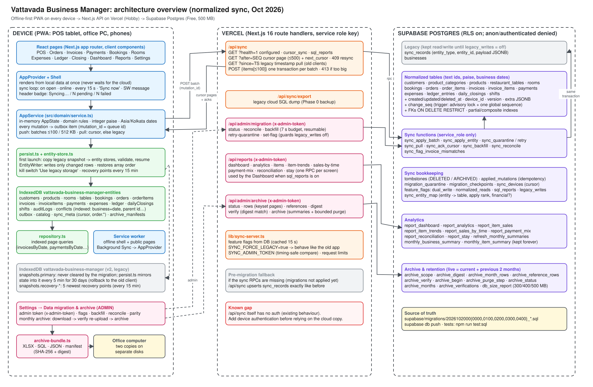
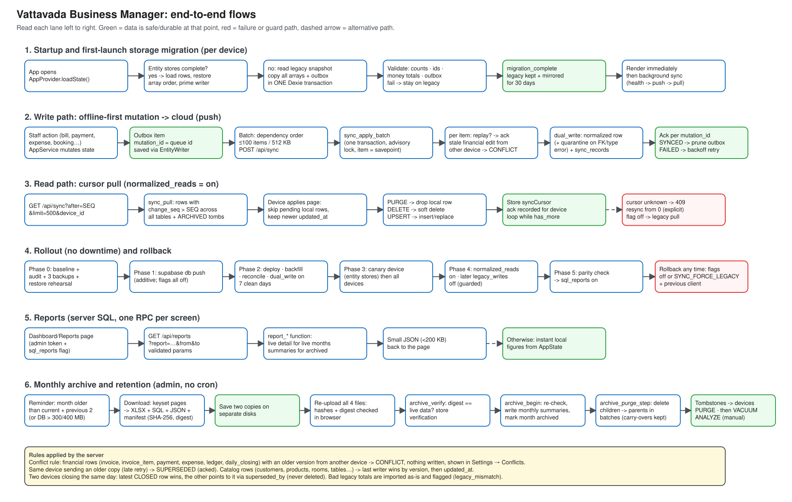

# Architecture

Vattavada Business Manager is an offline-first PWA for two stays and a restaurant. Every device works from its own local database and syncs in the background through a Next.js API on Vercel into Supabase Postgres. This document describes the current architecture: the normalized sync, entity stores, SQL reports and monthly archive from `plan-for-migration.v1-original.md`.

| Diagram | Editable source | Preview |
| --- | --- | --- |
| System overview | [`architecture/overview.excalidraw`](architecture/overview.excalidraw) | [`overview.svg`](architecture/overview.svg) |
| End-to-end flows | [`architecture/flows.excalidraw`](architecture/flows.excalidraw) | [`flows.svg`](architecture/flows.svg) |

To edit a diagram, open https://excalidraw.com, choose Menu → Open, and select the `.excalidraw` file. You can also change `architecture/generate.py` and run `python3 docs/architecture/generate.py`, which regenerates both the `.excalidraw` files and the SVG previews. The ASCII versions below render anywhere (GitHub, editors, terminals) and can be pasted into ascii.kdawg.dev.

## 1. System overview



```text
+------------------------------ DEVICE (PWA) ------------------------------+      +------------------- VERCEL (Next.js 16) -------------------+      +------------------ SUPABASE POSTGRES (Free) ------------------+
|                                                                          |      |                                                           |      |  RLS on; anon/authenticated denied; service_role only        |
|  React pages: POS, Orders, Invoices, Payments, Bookings, Rooms,          |      |  /api/sync                                                |      |                                                              |
|  Expenses, Ledger, Closing, Dashboard, Reports, Settings                 |      |    GET ?health=1      flags for clients                   |      |  LEGACY      sync_records (JSONB payload) . businesses       |
|            |                                                             |      |    GET ?after=SEQ     cursor page (<=500), 409 = resync   |      |                    ^                                         |
|            v                                                             |      |    GET ?since=TS      legacy pull (old clients)           |      |                    | same transaction                        |
|  AppProvider + Shell                                                     |      |    POST {items<=100}  one transaction per batch           |      |  NORMALIZED  customers . product_categories . products       |
|    render local data at once; sync on open/online/15 s/SW/'Sync now'     |      |                                                           |      |              restaurant_tables . rooms . bookings . orders   |
|            |                                                             |      |  /api/sync/export        legacy SQL dump (backup)         |      |              order_items . invoices . invoice_items          |
|            v                                                             |      |                                                           |      |              payments . expenses . ledger_entries            |
|  AppService (in-memory AppState, rules, paise, Asia/Kolkata)             |      |  /api/admin/migration    status . backfill . reconcile    |      |              daily_closings . shifts                         |
|    mutation -> outbox item (mutation_id)                                 |      |    (x-admin-token)       retry-quarantine . set-flag      |      |              + change_seq (trigger + advisory lock)          |
|    push: batches <=100 / 512 KB ------------- POST /api/sync ----------->|----->|                                                           |----->|              + tombstones . FKs ON DELETE RESTRICT           |
|    pull: cursor pages <---------------------- GET ?after=SEQ ------------|<-----|  /api/reports            one RPC per screen               |      |                    ^                                         |
|            |                                                             |      |    (x-admin-token)       dashboard . analytics . items    |      |  SYNC FUNCTIONS    |                                         |
|            v                                                             |      |                          sales-by-time . payment-mix      |      |    sync_apply_batch . sync_apply_entity . sync_pull          |
|  persist.ts + entity-store.ts                                            |      |                          reconciliation . stay            |      |    sync_backfill . sync_reconcile . sync_retry_quarantine    |
|    first launch: snapshot -> entity stores (validated, resumable)        |      |                                                           |      |                                                              |
|    EntityWriter: changed rows only; array order restored on load         |      |  /api/admin/archive      status . rows . references       |      |  BOOKKEEPING  tombstones . applied_mutations                 |
|            |                                   |                         |      |    (x-admin-token)       digest . verify . archive        |      |               migration_quarantine . migration_checkpoints   |
|            v                                   v (mirror 5 min x 30 d)   |      |                                                           |      |               sync_devices . feature_flags . sync_entity_map |
|  IndexedDB  ...-entities         IndexedDB  vattavada-business-manager   |      |  lib/sync-server.ts                                       |      |                                                              |
|   per-entity stores (indexed)     snapshots.primary (rollback copy)      |      |    flags from DB (cached 15 s)                            |      |  ANALYTICS   report_* functions                              |
|   outbox . catalog . sync_meta    snapshots.recovery-* (every 15 min)    |      |    SYNC_FORCE_LEGACY kill switch                          |      |              monthly_business_summary (kept forever)         |
|   archive_manifests                                                      |      |    SYNC_ADMIN_TOKEN . request limits                      |      |              monthly_item_summary     (kept forever)         |
|            |                                                             |      |                                                           |      |                                                              |
|            v                                                             |      |  Pre-migration fallback: if RPCs are missing,             |      |  ARCHIVE     archive_scope . archive_digest . archive_verify |
|  repository.ts (indexed queries)   Service worker (offline, BG sync)     |      |  /api/sync upserts sync_records like before               |      |              archive_begin . archive_purge_step              |
|                                                                          |      |                                                           |      |              archive_months . db_size_report                 |
|  Settings -> Data migration & archive (ADMIN) ------ x-admin-token ----->|----->|  Known gap: /api/sync itself has no auth (pre-existing)   |      |                                                              |
|    archive-bundle.ts: XLSX + SQL + JSON + manifest -> 2 local disks      |      |                                                           |      |  source of truth: supabase/migrations/*.sql                  |
+--------------------------------------------------------------------------+      +-----------------------------------------------------------+      +--------------------------------------------------------------+
```

### Components

| Layer | Component | Responsibility |
| --- | --- | --- |
| Device | `src/app/*` pages | UI. Reads the in-memory `AppState` through `useApp()`. |
| Device | `src/ui/AppProvider.tsx` | Loads local data, renders immediately, and runs the background sync loop. |
| Device | `src/domain/service.ts` | Domain rules, the outbox, batched push, cursor pull, and conflict recording. |
| Device | `src/db/persist.ts`, `src/db/entity-store.ts` | The one-time snapshot → entity-store migration, incremental writes, order restore, and rollback mirror. |
| Device | `src/db/repository.ts` | Indexed IndexedDB queries (by business and date, by parent ID). |
| Device | `src/ui/admin-migration-panel.tsx`, `src/lib/archive-bundle.ts` | Admin controls and the monthly archive files. |
| Server | `src/app/api/sync/route.ts` | Sync ingest and pull, plus the legacy fallback. |
| Server | `src/app/api/admin/*`, `src/app/api/reports/route.ts` | Migration controls, reports and archive (admin token required). |
| Server | `src/lib/sync-server.ts` | Feature flags, kill switch, admin auth, limits. |
| Database | `supabase/migrations/2026102000*` | Schema, sync functions, analytics, archive and retention. |

### Feature flags (`public.feature_flags`)

| Flag | Effect when on |
| --- | --- |
| `dual_write` | Each push writes `sync_records` and the normalized tables in one transaction. |
| `normalized_reads` | `GET /api/sync?after=` serves cursor pages. Clients fall back to the legacy pull while this is off. |
| `sql_reports` | The dashboard uses SQL totals on admin devices. |
| `legacy_writes` | Keeps writing `sync_records`. It can only be turned off once every device runs the new client. |

`SYNC_FORCE_LEGACY=true` (a Vercel env var) overrides all of these.

## 2. End-to-end flows



### 2.1 Startup and first-launch storage migration

```text
 App opens
     |
     v
 loadState() -- entity stores complete? --yes--> load rows -> restore array order (sync_meta order.*)
     |                                            -> prime EntityWriter -> render
     no
     |
     v
 read legacy snapshot "primary"  (never cleared)
     |
     v
 ONE Dexie transaction: copy every array + pending outbox into the entity stores
     |
     v
 validate: row counts . ids . money totals . outbox size
     |                         |
    ok                       fail --> keep using the legacy snapshot (error shown in Settings)
     |
     v
 migration_complete . legacy mirror on for 30 days (rollback to old client still works)
     |
     v
 render immediately --> background: health -> push outbox -> pull changes -> save
```

### 2.2 Write path (offline-first push)

```text
 Staff action (bill / payment / expense / booking / closing)
     |
     v
 AppService mutates AppState  -->  outbox item {mutation_id = queue id}  -->  EntityWriter saves changed rows
     |                                                                         (safe on the device)
     v  (online, every 15 s or on change)
 order by dependency (customer -> order -> invoice -> items -> payment -> ledger)
 split into batches: <= 100 items and <= 512 KB
     |
     v
 POST /api/sync {device_id, client_version, items[]}
     |
     v
 sync_apply_batch  (one transaction, advisory lock, one savepoint per item)
     |
     +-- mutation_id already applied? ---------------------> ack SYNCED (duplicate, nothing written)
     +-- financial row, older version, other device ------> CONFLICT (+ remote copy) -> Settings > Conflicts
     +-- older copy from the same device / catalog LWW ---> SUPERSEDED -> ack SYNCED
     +-- dual_write on: upsert normalized row
     |       FK / bad value? -> migration_quarantine (retried when the parent arrives)
     +-- legacy_writes on: upsert sync_records (same transaction)
     |
     v
 per-item results by mutation_id
     |-- SYNCED  -> mark row SYNCED, delete outbox item
     |-- FAILED  -> keep, exponential backoff (5 s .. 5 min), shown in header badge
     '-- CONFLICT-> conflict record, outbox item parked
```

### 2.3 Read path (cursor pull)

```text
 GET /api/sync?after=<syncCursor>&limit=500&device_id=...
     |
     +-- normalized_reads off --> {cursor_supported:false} --> legacy pull: since = lastPulledAt - 2 min
     +-- cursor > server max  --> 409 resync_required      --> restart from cursor 0 (explicit snapshot)
     |
     v
 sync_pull: rows with change_seq > cursor from all 15 tables + ARCHIVED tombstones, ordered by change_seq
 (writers hold one advisory lock until commit, so change_seq order == commit order: nothing is skipped)
     |
     v
 device applies the page:
   pending local edit?  -> keep local
   PURGE                -> remove local row (archived on server)
   DELETE               -> set deleted_at
   UPSERT               -> insert or replace if newer (updated_at)
     |
     v
 store syncCursor (server records it as the device's acknowledged cursor) --> repeat while has_more
```

### 2.4 Rollout and rollback

```text
 Phase 0  baseline + audit + 3 backups (db dump, cloud export, device JSON) + restore rehearsal
    |
 Phase 1  supabase db push (additive; every flag off; app unchanged)
    |
 Phase 2  deploy -> backfill (resumable) -> reconcile -> dual_write ON -> 7 clean days
    |
 Phase 3  canary device (entity stores) -> one production device -> all devices
    |
 Phase 4  normalized_reads ON -> all devices on cursor sync -> legacy_writes OFF (guarded)
    |
 Phase 5  report parity check (90 days) -> sql_reports ON
    |
 Phase 6  monthly archive (after 30 stable days)

 Rollback at any point:  flags OFF  or  SYNC_FORCE_LEGACY=true  (+ previous client build)
                         devices reopen the mirrored legacy snapshot; normalized tables stay, unused.
```

### 2.5 Reports

```text
 Dashboard / Reports page
     |-- admin token + sql_reports ON --> GET /api/reports?report=...&from&to  (validated)
     |                                        |
     |                                        v
     |                                   report_* SQL function
     |                                     live months     -> normalized detail rows
     |                                     archived months -> monthly summaries
     |                                        |
     |                                        v
     |                                   small JSON -> page
     '-- otherwise --> instant local figures from AppState
```

### 2.6 Monthly archive and retention

```text
 Reminder (dashboard + Settings): a month older than current + previous 2, or DB > 300/400 MB
     |
     v
 Download: GET /api/admin/archive?action=rows (keyset pages) + references
     |      browser builds  vbm-archive-YYYY-MM.xlsx / .sql / .json / .manifest.json
     |      (manifest = SHA-256 of each file + digest: counts, totals, sha256 of sorted ids)
     v
 Save two copies on separate disks
     |
     v
 Re-upload all 4 files -> browser checks hashes and recomputes the digest
     |
     v
 POST verify: server digest of live data == uploaded digest ?  --no--> download again
     | yes
     v
 POST archive: archive_begin   re-check digest, write monthly summaries, mark month archived
               archive_purge_step (repeat): delete children -> parents in batches of 500,
               rows still referenced by newer data are carried over
     |
     v
 hard deletes leave ARCHIVED tombstones -> devices drop those rows on their next pull
     |
     v
 VACUUM ANALYZE in the Supabase SQL editor (manual maintenance step)
```

## 3. Server rules

- **Money and dates.** Money is always integer paise. Business dates are Asia/Kolkata calendar dates, and timestamps are UTC.
- **Conflicts.** For financial rows (invoice, invoice item, payment, expense, ledger, daily closing), an older version arriving from a different device is a conflict. Nothing is written and the conflict appears in Settings → Conflicts. An older copy from the same device is acknowledged as superseded. Catalog rows use last-writer-wins by version, then `updated_at`.
- **Duplicate closed days.** When two devices close the same day, the latest `CLOSED` row wins. The other row points to it via `superseded_by` and is never deleted.
- **Legacy data.** Rows are imported as they are. Invoices whose totals don't reconcile are flagged `legacy_mismatch`. Rows that can't be normalized are quarantined and reported by reconcile.
- **Retention.** Live detail covers the current month and the previous two. Older months survive as permanent monthly summaries plus the archive files.
