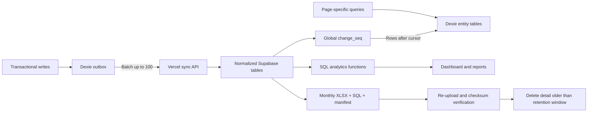

# Scalable Data Migration Plan (maintenance-window version)

The original plan (`plan-for-migration.v1-original.md`) used a long dual-write rollout so production never stopped. Since up to one hour of downtime is acceptable, this version replaces dual-write, the 7-day reconciliation soak and the 30-day mirrored `sync_records` with **one backfill, one verified cutover, and a dump kept for rollback**. Everything that protects correctness (backups, idempotency, cursor sync, tombstones, verification gates) is kept.

## Target architecture

- Live detail: current calendar month plus previous two months.
- `monthly_business_summary` and `monthly_item_summary` kept indefinitely so old totals/trends survive archiving.
- Older bills/payments/expenses are available from local archive bundles, not live drill-down.
- Stay inside Supabase Free (500 MB, no automatic backups, pauses after ~1 week of inactivity) and Vercel Hobby (10 s function limit): indexed SQL, batched requests, no cron, manual archives.

## Decisions (settled)

1. **Conflict rule.** Financial rows (invoices, payments, expenses, daily closings, ledger) are append-mostly: a write with a stale `version` is rejected by `apply_mutations` and recorded in the existing `conflicts` list for a manager to resolve; it is never silently overwritten. Catalog rows (products, categories, customers, rooms, tables) use last-writer-wins by `version`, then `updated_at`.
2. **Total mismatches.** Legacy data is imported as-is, never silently "fixed". Any invoice whose total does not reconcile to its item snapshots/discount/tax, or whose paid/balance does not match payments, is listed in the Phase 0 audit report and stored with a `legacy_mismatch` flag. The cutover gate is: counts and sums match exactly between legacy and normalized, and the only reconciliation differences allowed are the flagged rows already in the audit report (no new ones).
3. **Duplicate daily closings.** The latest `CLOSED` row per `(business_id, business_date)` wins and becomes the row in `daily_closings`. The others are kept in `audit_logs`/a `daily_closings_superseded` table, not deleted. Then add the unique constraint.
4. **Stale devices after cutover.** No legacy compatibility. After cutover `/api/sync` (v1) POST returns HTTP 426 with `min_client_version`, and old clients show a blocking "Update required" screen. Unsynced work on an old device must be exported to JSON (backup) before updating; the new client can import it.
5. **Maintenance window.** Tonight, Tue 20 Oct 2026, 11:00 PM IST is booked, but the build work (Phases 1-3) is not done, so **tonight is used for the Phase 0 backup/baseline only** (read-only, no downtime needed beyond asking staff to leave devices synced). The real cutover (Phase 4) is a separate 11:00 PM-12:00 AM IST window, scheduled only after the dress rehearsal passes. Pencil in a date once Phase 3 has a finish estimate.

## Phase 0: Preflight audit, backups, restore rehearsal (no production change)

- Run read-only audit queries on `sync_records.payload`:
  - Orphans (invoice_items without invoice, payments without invoice, order_items without order, etc.).
  - Duplicate IDs, duplicate `(business_id, business_date)` closings, missing `business_date`, non-integer money.
  - Invoice totals vs item snapshots/discount/tax; payment totals vs invoice paid/balance.
  - Output a report; resolve with decisions 2 and 3 above and write the exact fix-up rules into the backfill function.
- Capture baselines: row counts by entity, invoice/payment/expense totals (paise) by business and month, min/max timestamps, database size, device list.
- Three independent backups, each with a manifest (SHA-256, row counts, totals in paise, export time, schema version, device ID):
  - `supabase db dump` (logical).
  - Existing cloud SQL export from `src/app/api/sync/export/route.ts`.
  - Local JSON export from **every active device** via `src/domain/backup.ts`, saved off the device (not only in browser storage; `persist.ts` recovery snapshots live in the same IndexedDB).
- Restore the dump into local Postgres and run the baseline queries. Proceed only if counts and totals match exactly.
- Tag production as checkpoint `v1-json-sync`; keep it until 30 days after cutover.
- Set up `supabase/migrations/` (`supabase init`, `supabase link`); `supabase/migrations` does not exist yet.

## Phase 1: Build server side (deployed, but not used yet)

All additive; the live app keeps using the old `/api/sync`.

- Migrations via `supabase migration new` (never edit production schema by hand).
- Normalized tables mirroring existing text IDs and paise values: `customers`, `products`, `product_categories`, `restaurant_tables`, `orders`, `order_items`, `bookings`, `rooms`, `invoices`, `invoice_items`, `payments`, `expenses`, `ledger_entries`, `daily_closings`, `shifts`.
- Every syncable table: `created_at`, `updated_at`, `deleted_at`, `device_id`, `version`, and `change_seq` (one shared Postgres sequence, assigned on every insert/update/soft delete).
- `invoice_items.product_id` nullable; keep name/price snapshots so old bills never change.
- `ON DELETE RESTRICT` on financial foreign keys; soft deletes; permanent `tombstones(entity_type, entity_id, change_seq)`.
- `applied_mutations(mutation_id primary key, ...)` for idempotent retries.
- Indexes for real access patterns: issued invoices by `(business_id, business_date)`; items by parent and product; payments/expenses/ledger by `(business_id, business_date)`; orders by `(business_id, created_at)` and status; bookings by property/check-in/out/active; unique daily closing by `(business_id, business_date)`; every table by `change_seq`.
- RLS enabled; anon denied on financial tables; service role only inside server routes.
- Postgres functions:
  - `apply_mutations(batch jsonb)`: one transaction per batch, dedupes by `mutation_id`, enforces the conflict rule, returns per-mutation results.
  - `backfill_from_sync_records()`: idempotent `INSERT ... ON CONFLICT DO UPDATE`, bounded batches, resumable by checkpoint, applies the Phase 0 fix-up rules.
  - `reconcile()`: compares legacy vs normalized counts, IDs, deleted rows and financial totals; admin-only.
- New API `/api/v2/sync`: `GET ?after=<seq>&limit=500` returning rows and `next_cursor` (invalid/too-old cursor returns an explicit `resync_required`); `POST` batches capped at 100 mutations / 512 KB. Keep within the 10 s Vercel limit.
- `supabase/schema.sql` is regenerated as a current-schema reference only after migrations are proven.

## Phase 2: Build client side (feature-flagged off)

- New Dexie version (`src/db/persist.ts`) with per-entity stores plus `outbox`, `sync_meta`, `archive_manifests`, and small catalog/session stores. Index by business, date, status, customer, product, parent ID, and `change_seq`.
- One-time migration on first launch of the new client (forced, not optional):
  1. Keep the `primary` snapshot untouched as rollback data.
  2. Set `migration_started`.
  3. Bulk-copy arrays into entity stores in a Dexie transaction.
  4. Validate counts, IDs, totals and pending queue rows.
  5. Set `migration_complete` only on success.
  - Resumable if interrupted; never auto-clear the old snapshot.
- Convert any pending `syncQueue` items into `outbox` rows with generated `mutation_id`s.
- `src/db/repository.ts` plus indexed/live-query hooks. High-volume pages first: invoices, orders, payments, ledger, expenses, dashboard.
- `src/ui/AppProvider.tsx`: render from local tables immediately; sync in the background with visible progress.
- Outbox: batches of up to 100; ack per item; delete acknowledged rows; failed rows keep backoff and a visible error; preserve dependency order order → invoice → items → payment.
- Backup format v1 import maps into the new stores; introduce format v2 for normalized exports.
- Client sends `client_version`; server rejects old versions after cutover.

## Phase 3: Dress rehearsal (production copy, no production change)

- Create a second Supabase project from the Phase 0 dump; run the full cutover script against it.
- Load a production JSON backup into a non-primary device/browser profile; run the client migration; compare counts/totals.
- Run the sync test matrix: offline writes, duplicate retries, interrupted migration, stale cursor, two concurrent devices, partial batch failure, delete tombstones, rollback to old snapshot.
- Time each step; the full cutover must fit comfortably under 45 minutes. If not, shrink the scope.

## Phase 4: Cutover (the one-hour maintenance window)

Target timeline (T = start):

| Time | Step |
|------|------|
| T-1 day | Announce window; confirm every device is online and fully synced; last device JSON exports saved off-device |
| T+0 | Turn on maintenance mode (old `/api/sync` POST returns 503; clients keep working offline) |
| T+5 | Fresh `supabase db dump` + cloud SQL export + manifests |
| T+15 | Run `backfill_from_sync_records()` |
| T+25 | Run `reconcile()`; require 0 missing/extra IDs and exact totals (or only the pre-approved waived items) |
| T+30 | Flip server flag: `/api/v2/sync` live; old API read-only |
| T+35 | Deploy new client; open it on the primary device; migrate Dexie; sync; compare totals |
| T+45 | Smoke test: create order → invoice → payment on two devices, go offline/online, check dashboard totals |
| T+55 | End maintenance; staff update their devices |

- **Abort rule:** if reconcile or smoke test fails by T+45, flip the flag back, redeploy the previous client, end maintenance. Nothing was deleted, so the old path still works.
- Other devices update as they come online; each runs the forced local migration and then cursor sync.

## Phase 5: Post-cutover monitoring and rollback window (30 days)

- Daily for the first week: `reconcile()` counts vs devices' counts, outbox backlog, `resync_required` events, error logs.
- Keep for 30 days: old `sync_records` (read-only), `v1-json-sync` dump, old Dexie `primary` snapshot, previous client build.
- Rollback during this period: disable the v2 flag, redeploy the prior client. Normalized tables remain harmless; never drop populated tables. Any data written after cutover must be exported from the normalized tables first, since the old path will not have it.
- After 30 stable days: export and drop `sync_records`, and remove the old snapshot from devices.

## Phase 6: Server-side analytics (after cutover)

- Canonical model: issued invoices = billed revenue; payments = collections; expenses = costs; ledger = accounting reconciliation. Integer paise; business dates in Asia/Kolkata.
- SQL functions returning small result sets: dashboard summary (day/month/year); item sales by product; sales by Kolkata hour and morning/afternoon/evening buckets; sales by weekday; best/least sellers (left join for zero-sale products); monthly item rankings; payment-method mix; bill/payment/expense/closing reconciliation; stay occupancy, ADR, RevPAR, booking source, cancellation/no-show.
- `monthly_business_summary` and `monthly_item_summary` tables, written before any purge.
- Thin routes under `src/app/api/reports/` that validate input and call one RPC per screen. No large aggregation in Vercel or the browser.
- Switch `src/app/dashboard/page.tsx` and `src/app/reports/page.tsx` only after SQL results match local calculations for every day in the overlap period.

## Phase 7: Archive and retention (separate follow-up; not needed at launch)

Not urgent: three businesses will take years to approach 400 MB. Start only after cutover is stable.

- Monthly in-app admin reminder from `archive_manifests` (no cron).
- "Download monthly archive": one `.xlsx` (bills, items, payments, expenses, bookings, ledger, products, reconciliation), one restorable SQL dump, one JSON manifest (checksums, counts, totals, schema version, date range).
- Admin must re-upload the bundle for checksum/row-count validation before "Archive this month" is enabled. A download alone never allows deletion.
- Only months outside the rolling three-month window; write/update monthly summaries first; delete children before parents in bounded transactions; run `VACUUM ANALYZE` via an approved maintenance step.
- Keep two copies of each archive on separate disks. Settings shows DB size with a warning at 300 MB and an alert at 400 MB.
- Begin purging only after one successful export, re-upload validation, a local restore rehearsal and 30 stable production days.

## Verification gates and success criteria

- Invariants: IDs unique; no orphaned foreign keys; invoice totals reconcile to item snapshots, discounts and tax (or are on the approved waiver list); payments reconcile to invoice paid/balance; ledger and expenses reconcile by business date.
- Parity: normalized vs legacy counts/totals match exactly before flipping; every missing/extra ID reported.
- Recovery: restore the dump and archive bundle into an empty local database and reproduce monthly totals before any purge.
- Sync tests: the matrix in Phase 3 passes on rehearsal and again after cutover.
- Performance (realistic target 20,000 synthetic records; 100,000 optional stress): warm startup under 1.5 s, first usable screen without waiting for cloud, incremental sync under 5 s, outbox below 100 after reconnect, report payloads under 200 KB.
- Free-tier: DB under 400 MB, no full-dataset startup transfer, one batched request per 100 mutations, report screens use indexed SQL/RPC.

## Key code areas

- Local persistence: `src/db/persist.ts`, new `src/db/repository.ts`.
- Startup/background sync: `src/ui/AppProvider.tsx`.
- Domain mutations/outbox: `src/domain/service.ts`, `src/domain/types.ts`, `src/domain/rules.ts`.
- Cloud sync/export: `src/app/api/sync/route.ts`, `src/app/api/sync/export/route.ts`, `src/domain/cloud-backup.ts`, new `src/app/api/v2/sync/`.
- Database: `supabase/schema.sql` plus new `supabase/migrations/`.
- Analytics UI: `src/app/dashboard/page.tsx`, `src/app/reports/page.tsx`, new `src/app/api/reports/`.
- Backup/admin UX: `src/app/settings/page.tsx`, `src/domain/backup.ts`.

## What changed vs the original plan

- Removed: server dual-write, 7-day clean-reconciliation soak, long canary period, mirrored `sync_records` writes, separate per-phase feature-flag rollout.
- Added: Phase 0 data audit, explicit decisions list, dress rehearsal on a Supabase copy, timed cutover runbook with abort rule, forced client update.
- Kept: three backups with manifests and restore proof, idempotent `mutation_id`, cursor sync, tombstones, forced non-destructive Dexie migration, 30-day rollback assets, archive-before-purge safeguards (moved to a later follow-up).
