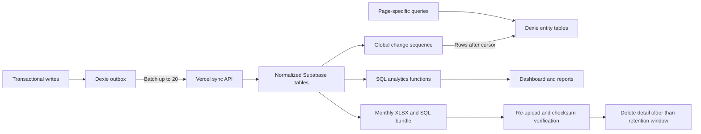

# Scalable Data Migration Plan

## Target architecture

- Keep detailed live data for the current calendar month plus the previous two months.
- Preserve `monthly_business_summary` and `monthly_item_summary` indefinitely so old monthly totals and trends remain visible after detail is archived.
- Older individual bills, payments, and expenses are available from local archive bundles, not live drill-down.
- Stay within Supabase Free’s current 500 MB database limit and Vercel Hobby constraints by using indexed SQL aggregates, batched requests, no frequent cron, and manual verified monthly archives.

## Phase 0: Baseline, backup, and recovery rehearsal

- Freeze schema-changing production deployments during the migration window.
- Capture production baselines: row counts by entity, invoice/payment/expense totals by business and month, min/max timestamps, database size, and current device cursors.
- Create three independent backups before any migration:
  - Supabase logical dump using `supabase db dump`.
  - Existing cloud SQL export from [`src/app/api/sync/export/route.ts`](src/app/api/sync/export/route.ts).
  - Local JSON export from every active device through [`src/domain/backup.ts`](src/domain/backup.ts).
- Store a manifest beside each backup containing SHA-256, row counts, totals in paise, export time, schema version, and device ID.
- Restore the dump into local Postgres and run reconciliation queries. Do not continue unless restored counts and financial totals exactly match production.
- Record current production as migration checkpoint `v1-json-sync` and retain it until 30 days after cutover.

## Phase 1: Add normalized Supabase schema without changing production behavior

- Create migrations using `supabase migration new`; do not rewrite production schema manually.
- Add normalized tables mirroring existing IDs and paise values: `customers`, `products`, `product_categories`, `restaurant_tables`, `orders`, `order_items`, `bookings`, `rooms`, `invoices`, `invoice_items`, `payments`, `expenses`, `ledger_entries`, `daily_closings`, and `shifts`.
- Keep existing text IDs to avoid changing production references. Add `created_at`, `updated_at`, `deleted_at`, `device_id`, `version`, and a global `change_seq` generated from one Postgres sequence.
- Add nullable `invoice_items.product_id`; retain item name and price snapshots so historical bills never change when products are edited.
- Add foreign keys with `ON DELETE RESTRICT` for financial relationships and use soft deletes. Keep permanent tombstones for deleted IDs.
- Add partial/composite indexes for actual access patterns:
  - Issued invoices by `(business_id, business_date)`.
  - Invoice/order items by parent and product.
  - Payments, expenses, and ledger by `(business_id, business_date)`.
  - Orders by `(business_id, created_at)` and status.
  - Bookings by property, check-in/out, and active status.
  - Unique daily closing by `(business_id, business_date)`.
  - Every syncable table by `change_seq`.
- Keep RLS enabled; deny anon access to financial tables and use the service role only inside server routes.
- Update [`supabase/schema.sql`](supabase/schema.sql) only as a generated/current-schema reference after migrations are proven.

## Phase 2: Backfill and dual-write compatibility

- Backfill normalized tables from `sync_records.payload` with idempotent `INSERT ... ON CONFLICT ... DO UPDATE` statements, preserving `deleted_at`, version, device, and original timestamps.
- Extend [`src/app/api/sync/route.ts`](src/app/api/sync/route.ts) so old clients continue writing `sync_records` while the server also writes normalized tables.
- Perform each batch through one transactional Postgres function so either both representations update or neither does.
- Add a reconciliation endpoint restricted to admins that compares normalized vs legacy counts, IDs, deleted rows, and financial totals.
- Run backfill in bounded batches and resume by checkpoint; never truncate or mutate `sync_records` during this phase.
- Gate normalized reads behind a server-side feature flag. Keep legacy reads active until reconciliation is clean for seven consecutive days.

## Phase 3: Replace whole-state Dexie with entity stores

- Upgrade [`src/db/persist.ts`](src/db/persist.ts) to a new Dexie version with separate stores for each high-volume entity, plus `outbox`, `sync_meta`, `archive_manifests`, and small catalog/session stores.
- Index local tables by the same fields used by pages: business, date, status, customer, product, parent ID, and updated sequence.
- On first launch after deployment:
  1. Keep the existing `primary` snapshot untouched as rollback data.
  2. Set a `migration_started` marker.
  3. Bulk-copy every array into entity stores inside a Dexie transaction.
  4. Validate counts, IDs, totals, and pending queue rows.
  5. Set `migration_complete` only after validation succeeds.
- If migration fails or the browser closes, resume safely; never clear the old snapshot automatically.
- Add a repository layer such as `src/db/repository.ts` and page hooks based on Dexie indexed queries/live queries. Migrate high-volume pages first: invoices, orders, payments, ledger, expenses, and dashboard.
- Stop blocking startup on cloud hydration in [`src/ui/AppProvider.tsx`](src/ui/AppProvider.tsx): render from local indexed tables immediately, then synchronize in the background with visible progress.
- Keep JSON import compatibility by mapping backup format v1 into the new stores. Introduce backup format v2 for normalized exports.

## Phase 4: Cursor sync, batching, and queue pruning

- Replace timestamp/offset pulls with a monotonic global `change_seq` cursor. `/api/sync?after=<seq>&limit=500` returns rows and `next_cursor`; no full startup download.
- Store the acknowledged cursor per device. If a cursor is invalid or too old, trigger an explicit snapshot resync rather than silently returning partial data.
- Replace one-request-per-record pushes with batches capped at 20 mutations and 512 KB.
- Add an idempotent `mutation_id` and unique constraint so retries cannot duplicate invoices or payments.
- Acknowledge queue item IDs individually. Delete acknowledged outbox rows immediately; retain failed rows with backoff and visible errors.
- Send only changed entities, not full `AppState`. Keep dependency ordering and transactional groups for order → invoice → items → payment.
- After all supported clients use cursor sync, stop writing legacy `sync_records`; retain it read-only for the 30-day rollback window, then export and remove it.

## Phase 5: Server-side financial analytics

- Define one canonical revenue model before UI work: issued invoices for billed revenue, payments for collections, expenses for costs, ledger entries for accounting reconciliation, all amounts as integer paise and all business dates in Asia/Kolkata.
- Add SQL views/functions returning small result sets:
  - Dashboard summary for today, month, year, revenue, payments, expenses, and profit.
  - Item sales by product/name, quantity, and revenue.
  - Sales by Kolkata hour and configurable morning/afternoon/evening buckets.
  - Sales by weekday, including Sunday ranking.
  - Best and least sellers; include active products with zero sales using a left join.
  - Monthly item rankings and trends.
  - Payment-method mix and bill/payment/expense/daily-closing reconciliation.
  - Stay occupancy, ADR, RevPAR, booking source, and cancellation/no-show trends.
- Retain small `monthly_business_summary` and `monthly_item_summary` rows indefinitely before purging raw detail. Historical dashboards use these summaries; live three-month drill-down uses normalized details.
- Add thin report routes under `src/app/api/reports/` that validate parameters and call one Supabase RPC per screen. Do not aggregate large datasets in Vercel or the browser.
- Update [`src/app/dashboard/page.tsx`](src/app/dashboard/page.tsx) and [`src/app/reports/page.tsx`](src/app/reports/page.tsx) only after SQL results match existing local calculations for the overlap period.

## Phase 6: Free-tier monthly archive and retention workflow

- Add a monthly in-app admin reminder based on `archive_manifests`; no cron is required and no browser can silently save to the office computer.
- Provide one “Download monthly archive” action producing:
  - One `.xlsx` workbook with bills, invoice items, payments, expenses, bookings, ledger, products, and reconciliation sheets.
  - One restorable SQL dump for that month.
  - One JSON manifest with checksums, counts, totals, schema version, and date range.
- Require the admin to re-upload the downloaded bundle for checksum and row-count validation before enabling “Archive this month.” Never delete merely because a download was initiated.
- Archive only months outside the rolling three-month detail window. First write/update permanent monthly summaries, then delete child rows before parents in bounded transactions and run `VACUUM ANALYZE` through an approved maintenance step.
- Keep at least two local copies of each archive on separate disks. Show unresolved archive reminders prominently.
- Add database-size monitoring in Settings with warnings at 300 MB and a hard operational alert at 400 MB, below Supabase Free’s 500 MB read-only threshold.

## Deployment and rollback plan

1. Deploy additive schema and indexes only; verify no application behavior changes.
2. Run backfill and reconciliation read-only reports; correct mappings without deleting legacy rows.
3. Deploy server dual-write with normalized reads disabled.
4. Canary the new Dexie migration on one non-primary device using a production backup copy.
5. Deploy client migration with legacy mode available; enable it for one production device and compare counts/totals after every sync.
6. Enable cursor reads and batch writes for all devices only after seven clean canary days.
7. Enable SQL dashboard/report reads after they match local calculations for every day in the overlap window.
8. Keep old Dexie snapshot, old API read path, `sync_records`, and database dump for 30 days.
9. Roll back by disabling feature flags and redeploying the prior client; normalized additions remain harmless. Never reverse migrations by dropping populated tables during the rollback window.
10. Start three-month archival only after one successful archive export, re-upload validation, local restore rehearsal, and 30 stable production days.

## Verification gates and success criteria

- Migration invariants: IDs unique; no orphaned foreign keys; invoice totals reconcile to item snapshots, discounts, and tax; payments reconcile to invoice paid/balance; ledger and expenses reconcile by business date.
- Data parity: normalized and legacy counts/totals match exactly before cutover; every missing/extra ID is reported.
- Recovery: restore SQL and XLSX/manifest into an empty local database and reproduce monthly totals before any purge.
- Sync tests: offline writes, duplicate retries, interrupted migration, stale cursor, concurrent devices, partial batch failure, delete tombstones, and rollback.
- Performance targets at 100,000 synthetic records: warm startup under 1.5 seconds, first usable screen without waiting for cloud, incremental sync under 5 seconds under normal load, queue below 100 after connectivity returns, and report payloads below 200 KB.
- Free-tier targets: database below 400 MB, no full-dataset startup transfer, one batched sync request per 20 mutations, and report screens using indexed SQL/RPC queries.

## Key code areas

- Local persistence and migration: [`src/db/persist.ts`](src/db/persist.ts), new `src/db/repository.ts`.
- Startup and background synchronization: [`src/ui/AppProvider.tsx`](src/ui/AppProvider.tsx).
- Domain mutations/outbox: [`src/domain/service.ts`](src/domain/service.ts), [`src/domain/types.ts`](src/domain/types.ts), [`src/domain/rules.ts`](src/domain/rules.ts).
- Cloud sync and exports: [`src/app/api/sync/route.ts`](src/app/api/sync/route.ts), [`src/app/api/sync/export/route.ts`](src/app/api/sync/export/route.ts), [`src/domain/cloud-backup.ts`](src/domain/cloud-backup.ts).
- Database definitions: [`supabase/schema.sql`](supabase/schema.sql) plus new `supabase/migrations/` files.
- Analytics UI: [`src/app/dashboard/page.tsx`](src/app/dashboard/page.tsx), [`src/app/reports/page.tsx`](src/app/reports/page.tsx), and new `src/app/api/reports/` routes.
- Backup/admin UX: [`src/app/settings/page.tsx`](src/app/settings/page.tsx), [`src/domain/backup.ts`](src/domain/backup.ts).

## To DOs 

- Capture production baselines, create Supabase/device backups, and prove a full restore before schema changes.

- Add indexed normalized Supabase tables, foreign keys, global change sequence, tombstones, and additive migrations.

- Backfill normalized tables, enable transactional dual-write, and reconcile legacy vs normalized data.

- Migrate the monolithic snapshot to per-entity Dexie stores with resumable validation and rollback.

- Enable cursor pulls, idempotent batch pushes, acknowledgements, retry backoff, and queue pruning.

- Move financial and item analytics to indexed SQL functions and retain compact historical monthly summaries.

- Build verified monthly XLSX/SQL exports and safely purge detail outside the rolling three-month window.

- Canary, reconcile, load-test, deploy behind flags, and retain 30-day rollback compatibility.

Even downtime is allowed for an hour , feel free to change the iplementations if its easier with downtime. 
## Implementation status (2026-10-20)

All code for phases 0–6 is implemented and was verified on a local Postgres 16 (with PostgREST standing in for Supabase) and in headless Chromium. Nothing has been applied to the live Supabase project yet. The production steps (backups, `supabase db push`, flag flips, canary days, the first archive) follow `docs/MIGRATION-RUNBOOK.md`.

Decisions made during implementation:

- **Conflicts:** a stale financial edit from another device returns `CONFLICT` and goes to the conflicts list. Catalog rows use last-writer-wins. A late retry from the same device is acknowledged as `SUPERSEDED`.
- **Rows that can't be normalized:** orphans and bad values go to `migration_quarantine` in the same transaction as the legacy write. They are retried automatically when the parent row arrives, and reconcile reports them.
- **Duplicate closed days:** the latest `CLOSED` row wins, and the older row points to it in `superseded_by`. Nothing is deleted.
- **Cursor ordering:** every writer holds one transaction-scoped advisory lock, so `change_seq` order equals commit order and a cursor can never skip a late commit.
- **Ledger entries:** these now sync to the cloud. Previously they existed only on devices.
- **Entity stores:** these live in a separate IndexedDB database, so the previous client can still open its own database after a rollback.
- **Pages:** they still read the in-memory state. Indexed queries are available in `src/db/repository.ts`, and archiving bounds how much data the in-memory state holds.
